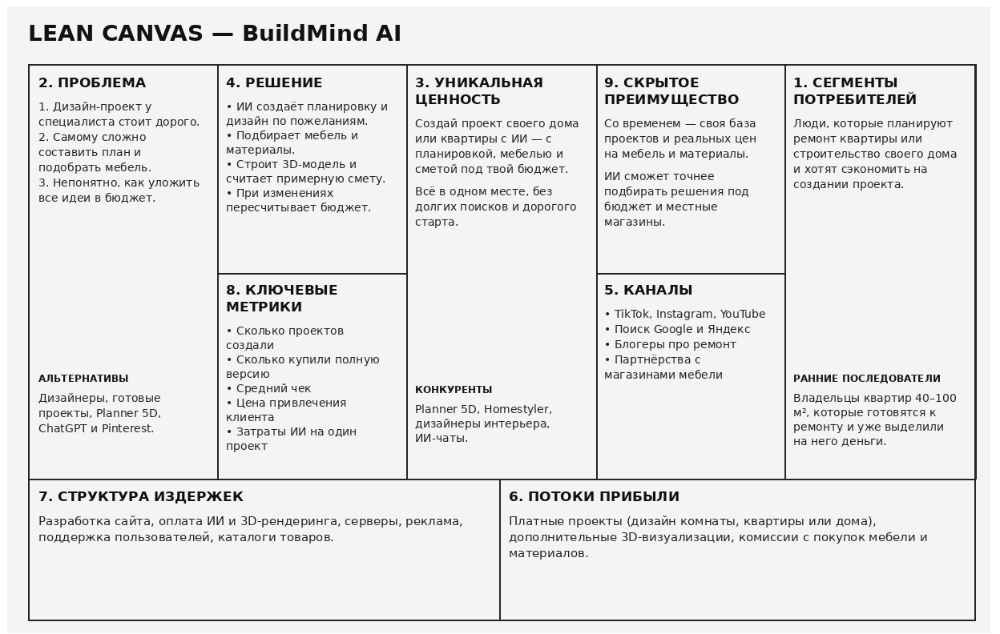

# Задание №1. Lean Canvas и Elevator Pitch

# BuildMind AI

**BuildMind AI — интеллектуальная платформа для проектирования жилья и дизайна интерьеров с помощью ИИ.**

## О проекте

BuildMind AI — это веб-сервис, который позволяет пользователям самостоятельно создавать персонализированные проекты квартир и частных домов без необходимости заказывать дорогостоящий дизайн-проект на начальном этапе.

**Бизнес-модель**: B2C

**Модель монетизации:** Freemium + Pay-per-Project.

Базовые функции доступны бесплатно, а за создание полноценного проекта, дополнительные визуализации и подробную смету пользователь платит отдельно.

Дополнительный источник дохода — партнёрские комиссии от магазинов мебели и строительных материалов.

**Целевая аудитория:** люди, планирующие ремонт квартиры или строительство частного дома, которые хотят получить индивидуальный дизайн и сократить расходы на проектирование.

## Elevator Pitch

Представьте, что вы приобрели квартиру или решили построить дом своей мечты. Вы знаете, каким хотите видеть своё жильё, но сталкиваетесь с проблемой: услуги профессиональных архитекторов и дизайнеров могут стоить дорого, а самостоятельно разработать удобную планировку, подобрать мебель и рассчитать бюджет достаточно сложно.

**Мы создаём BuildMind AI — интеллектуальную платформу, которая делает индивидуальное проектирование жилья доступным каждому.**

Наш сервис позволяет загрузить план квартиры или задать параметры будущего дома, описать свои пожелания и указать бюджет. Искусственный интеллект создаст варианты планировки, предложит оформление интерьера, подберёт мебель и материалы, подготовит 3D-визуализацию и предварительную смету.

**Наше главное преимущество — объединение дизайна и финансового планирования.** Пользователь не просто получает красивую картинку, а создаёт редактируемый проект, который адаптируется под его реальные финансовые возможности.

Мы планируем зарабатывать за счёт платных проектов и дополнительных функций, сохраняя базовые возможности бесплатными.

BuildMind AI ориентирован на людей, которые хотят получить персонализированную концепцию жилья с меньшими затратами времени и денег, прежде чем обращаться к специалистам для окончательной реализации.

**BuildMind AI — проектируй дом своей мечты, не выходя за рамки бюджета.**

## Lean Canvas

Бизнес-модель проекта представлена на схеме Lean Canvas.

# Задание №2. Гипотезы

## 1. HADI-гипотеза

### Главные риски

**Риск 1.** Пользователи могут не захотеть платить за AI-дизайн жилья, поскольку существуют бесплатные нейросети и онлайн-планировщики.

**Риск 2.** Пользователи могут не доверять проектам, созданным искусственным интеллектом, поскольку привыкли обращаться к профессиональным дизайнерам, архитекторам и инженерам, которые обладают специальным образованием и опытом.

Наиболее критичным считаем **первый риск**, поскольку даже при заинтересованности в продукте пользователи могут не увидеть смысла платить за него.

### H — Hypothesis (Гипотеза)

Мы предполагаем, что люди, планирующие ремонт квартиры или строительство частного дома, готовы воспользоваться AI-сервисом для создания индивидуального дизайн-проекта, если его стоимость будет значительно ниже стоимости аналогичных услуг профессиональных дизайнеров и архитекторов.

При этом наличие 3D-визуализации, подробной планировки, подбора мебели и расчёта бюджета должно повысить доверие пользователей к продукту.

**Критерий успеха:** минимум 1,5% посетителей сайта приобретут проект стоимостью 4 990 ₽.

### A — Action (Действие)

Для проверки гипотезы планируем:

1. Создать демонстрационный видеоролик, в котором пользователь вводит пожелания к будущему интерьеру, указывает бюджет, а BuildMind AI генерирует планировку, 3D-визуализацию и предварительную смету.
2. Создать лендинг с описанием сервиса, примерами проектов и сравнением возможностей BuildMind AI с традиционными услугами дизайнеров.
3. Разместить на сайте информацию о том, что сервис предназначен для предварительного проектирования, а сложные инженерные решения должны проверяться специалистами.
4. Запустить рекламу в социальных сетях и поисковых системах.

На первоначальном этапе проекты можно частично создавать вручную с помощью существующих AI-инструментов, чтобы проверить спрос до полноценной разработки платформы.

### D — Data (Данные)

Будем отслеживать:

- Количество посетителей сайта.
- Количество регистраций.
- Количество оплаченных проектов.
- Конверсию посетителей в покупку.
- Стоимость привлечения одного клиента (CAC).
- Причины отказа от покупки, включая недоверие к качеству AI-проектов.

### I — Insights (Выводы)

Если из 1 000 посетителей минимум 15 человек оплатят проект, гипотеза подтвердится.

Если покупок окажется меньше, необходимо выяснить причины отказа.

Если пользователи считают стоимость слишком высокой, можно изменить тарифы или состав платных функций.

Если основной причиной станет недоверие к ИИ, можно добавить экспертную проверку готовых проектов, больше примеров результатов и отзывы реальных пользователей.

---

## 2. Базовая юнит-экономика

Для расчёта используем тариф **Apartment Design — 4 990 ₽ за проект**.

### Предполагаемая воронка продаж

| Показатель | Значение |
|---|---:|
| Рекламный бюджет | 30 000 ₽ |
| Стоимость перехода (CPC) | 30 ₽ |
| Количество посетителей | 1 000 |
| Конверсия в регистрацию | 10% |
| Зарегистрированные пользователи | 100 |
| Конверсия из регистрации в покупку | 15% |
| Количество покупателей | 15 |
| Стоимость одного проекта | 4 990 ₽ |
| Общая выручка от первых покупок | 74 850 ₽ |

**Общая конверсия посетителей в покупку:**

15 / 1 000 × 100% = **1,5%**

### Расчёт CAC

**CAC = Рекламные расходы / Количество покупателей**

CAC = 30 000 / 15 = **2 000 ₽**

Таким образом, на привлечение одного клиента мы предполагаем тратить 2 000 ₽.

### Расчёт LTV

Поскольку ремонт и строительство происходят нечасто, предполагаем, что среднее количество покупок на одного клиента за всё время составит 1,1.

**LTV = Средний чек × Среднее количество покупок**

LTV = 4 990 × 1,1 = **5 489 ₽**

### Расчёт сходимости юнит-экономики

Предположим, что переменные расходы на создание одного проекта составляют 800 ₽. Сюда входят использование AI, генерация изображений и серверные ресурсы.

| Показатель | Значение |
|---|---:|
| LTV (выручка с клиента) | 5 489 ₽ |
| CAC | 2 000 ₽ |
| Переменные затраты на 1,1 проекта | 880 ₽ |
| Остаток после затрат | 2 609 ₽ |

**Расчёт остатка на одного клиента:**

5 489 − 2 000 − 880 = **2 609 ₽**

**Соотношение LTV/CAC:**

LTV/CAC = 5 489 / 2 000 = **2,74**

### Вывод по юнит-экономике

При заданных условиях юнит-экономика положительная.

Один привлечённый клиент приносит в среднем 2 609 ₽ после вычета рекламных и переменных затрат.

Соотношение LTV/CAC = 2,74 показывает, что прогнозируемая выручка от клиента превышает расходы на его привлечение примерно в 2,74 раза.

Однако для определения чистой прибыли необходимо дополнительно учитывать постоянные расходы на разработку, поддержку и обслуживание платформы.

---

## 3. План Б — Pivot

Если гипотеза не подтвердится и частные пользователи не будут готовы покупать AI-дизайн, изменим целевую аудиторию и бизнес-модель.

**Первоначальная модель:** B2C — продажа дизайн-проектов частным пользователям.

**Новая модель:** B2B SaaS — предоставление AI-инструмента небольшим дизайн-студиям, архитекторам и ремонтным компаниям.

### Как будет работать новая модель

Вместо самостоятельного проектирования жилья обычными пользователями BuildMind AI станет профессиональным помощником для дизайнеров и архитекторов.

Специалисты смогут использовать искусственный интеллект для ускорения разработки планировок, создания вариантов интерьера, 3D-визуализаций, подбора мебели и предварительного расчёта стоимости.

При этом окончательные решения будут принимать сами специалисты.

### Монетизация

- Подписка для компаний — 9 990 ₽ в месяц.
- Дополнительная оплата за большое количество AI-генераций.
- Расширенные тарифы для студий, одновременно работающих с несколькими клиентами.

### Почему Pivot может сработать?

Обычные пользователи нечасто занимаются ремонтом или строительством, поэтому могут не видеть смысла покупать специализированный AI-сервис.

Профессиональные дизайнеры и архитекторы, напротив, регулярно работают с подобными задачами.

Для них BuildMind AI может стать инструментом, который позволит быстрее выполнять рутинную работу, готовить варианты проектов и обслуживать больше заказчиков.

Кроме того, такой подход частично решает проблему недоверия к искусственному интеллекту, поскольку результаты генерации будут проверяться профессионалами.

Основные технологии платформы сохраняются, поэтому для перехода на новую бизнес-модель не потребуется полностью разрабатывать продукт заново.

---

## Итог

Предварительный расчёт юнит-экономики показал:

- **Стоимость проекта:** 4 990 ₽
- **CAC:** 2 000 ₽
- **LTV:** 5 489 ₽
- **LTV/CAC:** 2,74
- **Остаток после затрат на клиента:** 2 609 ₽

При выполнении наших предположений модель имеет положительную юнит-экономику: **2.74**.
