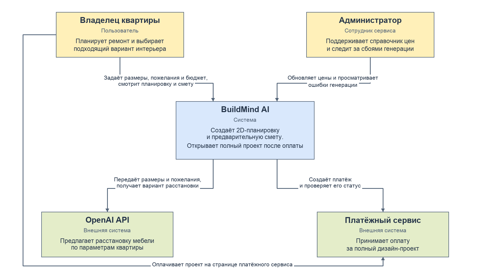
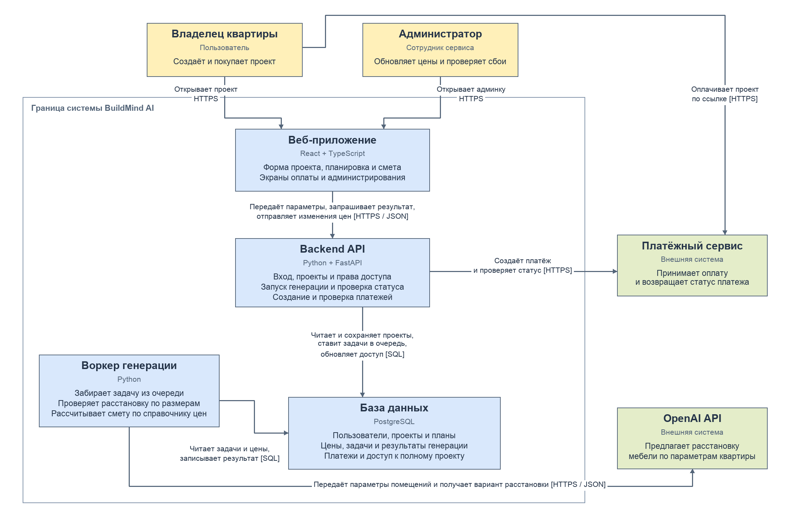

# ДЗ №5. C4 — BuildMind AI

## 1. Контекст

- Владелец квартиры вводит размеры, пожелания и бюджет, получает планировку и смету. Полный проект можно купить.
- Администратор обновляет цены и смотрит ошибки генерации.
- Через OpenAI API сервис получает вариант расстановки мебели.
- Владелец оплачивает проект на странице платёжного сервиса. BuildMind AI проверяет статус оплаты и открывает доступ.

## 2. Контейнеры

1. Веб-приложение отправляет параметры в API. API сохраняет задачу в PostgreSQL и возвращает её ID.
2. Воркер берёт задачу из базы, запрашивает расстановку через OpenAI API, проверяет размеры и считает смету по справочнику цен.
3. Воркер сохраняет результат или ошибку. Веб-приложение проверяет статус задачи через API и показывает результат либо кнопку повторного запуска.
4. При покупке API создаёт платёж и отдаёт ссылку на оплату. После подтверждения оплаты открывается полный проект.

## 3. Стек MVP

- **React + TypeScript** — формы проекта, экран результата и админка. TypeScript помогает согласовать данные на фронтенде с контрактами API.
- **Python + FastAPI** — HTTP API и проверка входных данных. Фоновый процесс на Python проверяет планировку и рассчитывает смету, пока API отвечает на запросы статуса.
- **PostgreSQL** — проекты, цены, платежи и задачи генерации. Таблица задач используется как очередь для воркера.

При размещении на одном VPS можно использовать Nginx для раздачи файлов React и передачи запросов `/api` в FastAPI.
